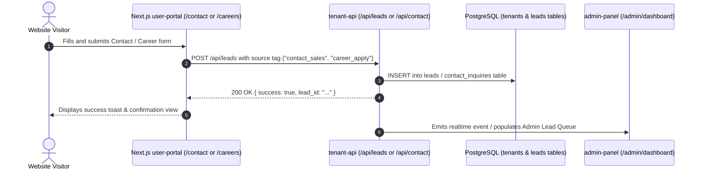
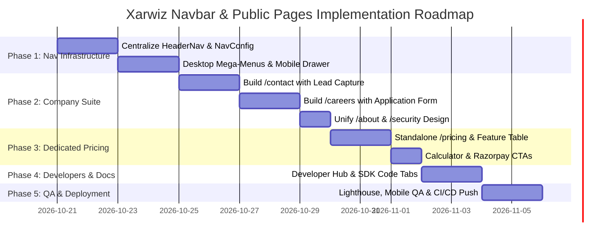

# Xarwiz — Navigation Bar Mega-Menus & Public Pages Implementation Plan

> **Document Version:** 1.0.0  
> **Target Platform:** Xarwiz AI Business Operating System & Cloud Platform (`xarwiz.com`)  
> **Status:** Architecture & Implementation Plan *(Awaiting Review Before Execution)*  
> **Scope:** Desktop & Mobile Navigation, Mega-Menus, and Dedicated Pages for `Platform ⌵`, `Solutions ⌵`, `Developers ⌵`, `Pricing`, `Resources ⌵`, and `Company ⌵`.

---

## Table of Contents
1. [Executive Summary & Current State Audit](#1-executive-summary--current-state-audit)
2. [Global Navigation Architecture & Component Design](#2-global-navigation-architecture--component-design)
3. [Mega-Menu & Page Specifications](#3-mega-menu--page-specifications)
   - [3.1 Company ⌵ (Priority Focus)](#31-company--priority-focus)
   - [3.2 Platform ⌵](#32-platform-)
   - [3.3 Solutions ⌵](#33-solutions-)
   - [3.4 Developers ⌵](#34-developers-)
   - [3.5 Pricing](#35-pricing)
   - [3.6 Resources ⌵](#36-resources-)
4. [Backend, API & Lead Ingestion Integrations](#4-backend-api--lead-ingestion-integrations)
5. [SEO, Analytics & Compliance Standards](#5-seo-analytics--compliance-standards)
6. [Phase-by-Phase Execution Roadmap](#6-phase-by-phase-execution-roadmap)
7. [Testing, QA & Rollout Verification Checklist](#7-testing-qa--rollout-verification-checklist)

---

## 1. Executive Summary & Current State Audit

### 1.1 Context
The Xarwiz homepage features a top navigation header with six primary categories:
```
[Logo]   Platform ⌵   Solutions ⌵   Developers ⌵   Pricing   Resources ⌵   Company ⌵   [Book a Demo] [Request Access]
```

### 1.2 Identified Architectural Gaps
| Category | Current Behavior in Codebase | Required Production Behavior |
| :--- | :--- | :--- |
| **Global Header** | Hardcoded in `user-portal/pages/neuravolt.js` and `landing/index.html`. Separate custom header in `about.js`. | Unified, reusable `HeaderNav.js` component shared across all public routes. |
| **Dropdowns** | Render static `ChevronDown` icons. Hover or click does nothing. | Full animated, accessible mega-menus on desktop; nested accordions in mobile drawer. |
| **Company ⌵** | `#company` anchor does not exist on page. Footer points Contact/Careers to `/login`. | Dedicated `/about` (harmonized), `/contact` (interactive lead form), and `/careers` (job board + application). |
| **Platform ⌵** | Scrolls to `#platform` anchor. Footer links point to `/signup`. | Interactive mega-menu showcasing Agent Builder, Workflows, RAG, Foundation Models, and Studio. |
| **Solutions ⌵** | Scrolls to `#solutions` anchor. Footer links point to `/signup`. | Vertical solutions menu for Enterprise AI, Healthcare, Fintech, and DPDP Compliance. |
| **Developers ⌵** | Scrolls to `#developers` anchor. Footer links point to `/signup`. | Developer hub linking to REST API reference, SDKs, Webhooks, and Connectors. |
| **Pricing** | Scrolls to `#pricing` anchor or auto-scroll redirect on `/pricing`. | Dedicated conversion-optimized page with Monthly/Annual toggle, feature comparison matrix, and FAQ. |
| **Resources ⌵** | Scrolls to `#resources`. Footer links to legal policies only. | Resource center covering Documentation, DPDP Compliance Whitepaper, Case Studies, and Policies. |

---

## 2. Global Navigation Architecture & Component Design

### 2.1 Component Structure
Extract and unify the fragmented headers into a single robust component structure in `user-portal/components/layout/`:

```
user-portal/components/layout/
├── HeaderNav.js                 # Primary global sticky header component
├── MegaMenu.js                  # Desktop mega-menu flyout with backdrop blur
├── MobileNavDrawer.js           # Responsive drawer with slide-out animation & accordions
└── NavDropdownData.js           # Central configuration file for all menu links, icons & badges
```

### 2.2 Navigation Data Configuration Schema (`NavDropdownData.js`)
```javascript
export const NAV_CONFIG = [
  {
    id: 'platform',
    label: 'Platform',
    hasDropdown: true,
    href: '/#platform',
    columns: [
      {
        sectionTitle: 'Core Capabilities',
        items: [
          { title: 'AI Agent Builder', desc: 'Build autonomous multi-agent systems with tool-calling', href: '/platform/agents', icon: 'Bot', badge: 'Popular' },
          { title: 'Workflow Automation', desc: 'Visual drag-and-drop node orchestrator & triggers', href: '/platform/workflows', icon: 'Workflow' },
          { title: 'Knowledge Base (RAG)', desc: 'Enterprise hybrid search with document citation', href: '/platform/knowledge-base', icon: 'Database' },
          { title: 'Multi-Language LLMs', desc: 'Support for Indian regional languages & open models', href: '/platform/models', icon: 'Cpu' },
          { title: 'Agentic Code Studio', desc: 'Browser sandbox, terminal execution & live previews', href: '/platform/studio', icon: 'Code2', badge: 'New' }
        ]
      }
    ]
  },
  {
    id: 'solutions',
    label: 'Solutions',
    hasDropdown: true,
    href: '/#solutions',
    columns: [
      {
        sectionTitle: 'Industry Solutions',
        items: [
          { title: 'Enterprise & Sovereign Cloud', desc: 'Private VPC isolation, DPDP data localization & SSO', href: '/solutions/enterprise', icon: 'Building2' },
          { title: 'Healthcare AI', desc: 'Clinical documentation & HIPAA/Indian healthcare norms', href: '/solutions/healthcare', icon: 'HeartPulse' },
          { title: 'Fintech & BFSI', desc: 'KYC, loan automation & Razorpay invoice reconciliation', href: '/solutions/fintech', icon: 'ShieldCheck' },
          { title: 'DPDP Statutory Compliance', desc: 'Consent manager, audit logs & statutory fiduciaries', href: '/solutions/dpdp', icon: 'FileCheck' }
        ]
      }
    ]
  },
  {
    id: 'developers',
    label: 'Developers',
    hasDropdown: true,
    href: '/developers',
    columns: [
      {
        sectionTitle: 'Developer Hub',
        items: [
          { title: 'API Reference', desc: 'REST endpoints, SSE streams & OpenAPI specs', href: '/developers', icon: 'Terminal' },
          { title: 'SDKs & Libraries', desc: 'Official client libraries for Python, Node.js & Go', href: '/developers/sdks', icon: 'Package' },
          { title: 'Webhooks & Events', desc: 'Real-time payload delivery with signature verification', href: '/developers/webhooks', icon: 'Webhook' },
          { title: 'Integrations', desc: 'Connect Slack, WhatsApp, Jira, GitHub & Google Drive', href: '/developers/integrations', icon: 'Boxes' }
        ]
      }
    ]
  },
  {
    id: 'pricing',
    label: 'Pricing',
    hasDropdown: false,
    href: '/pricing'
  },
  {
    id: 'resources',
    label: 'Resources',
    hasDropdown: true,
    href: '/resources',
    columns: [
      {
        sectionTitle: 'Knowledge & Trust',
        items: [
          { title: 'Documentation', desc: 'Comprehensive guides, tutorials & best practices', href: '/docs', icon: 'BookOpen' },
          { title: 'DPDP Compliance Guide', desc: 'Whitepaper on data localization & statutory rules', href: '/resources/dpdp-guide', icon: 'FileText' },
          { title: 'Case Studies', desc: 'How Indian enterprises automate with Xarwiz', href: '/resources/case-studies', icon: 'TrendingUp' },
          { title: 'Security & Trust Center', desc: 'Encryption, infrastructure safeguards & pen-tests', href: '/security', icon: 'Lock' }
        ]
      }
    ]
  },
  {
    id: 'company',
    label: 'Company',
    hasDropdown: true,
    href: '/about',
    columns: [
      {
        sectionTitle: 'About & People',
        items: [
          { title: 'About Xarwiz', desc: 'Our mission to build India\'s sovereign AI operating system', href: '/about', icon: 'Building' },
          { title: 'Contact Sales & Team', desc: 'Get in touch for enterprise deployments & live demos', href: '/contact', icon: 'Mail', badge: 'Fast Response' },
          { title: 'Careers', desc: 'Join our team shaping autonomous AI infrastructure', href: '/careers', icon: 'Sparkles', badge: 'We\'re Hiring' },
          { title: 'Grievance Redressal', desc: 'DPDP statutory nodal officer & customer grievances', href: '/grievance', icon: 'Scale' }
        ]
      }
    ]
  }
];
```

---

## 3. Mega-Menu & Page Specifications

### 3.1 Company ⌵ *(Priority Focus)*

```
┌─────────────────────────────────────────────────────────────┐
│ COMPANY MEGA-MENU                                           │
├─────────────────────────────────────────────────────────────┤
│  🏢 About Xarwiz          ✉️ Contact Sales & Support        │
│     Our mission, team &      Inquiries, demos & customized  │
│     Indian sovereign AI      enterprise cloud deployments   │
│                                                             │
│  ✨ Careers (Hiring)      ⚖️ Grievance Redressal            │
│     Join us building         DPDP statutory officer &       │
│     autonomous AI systems    regulatory compliance channel  │
└─────────────────────────────────────────────────────────────┘
```

#### Page 1: About Us (`user-portal/pages/about.js`)
* **Objective:** Establish sovereign enterprise credibility, team transparency, and product mission.
* **Key Content Sections:**
  1. *Hero:* "Building India's Sovereign AI Business Operating System."
  2. *The Problem:* Tool fragmentation vs Unified Enterprise AI.
  3. *Our Technology:* Fullstack AI Agent runtime, Document RAG, and Workflow engine.
  4. *Leadership & Team:* Founder Ashish Tomar, engineering culture, and advisor backing.
  5. *Commitment to Sovereignty:* 100% Indian data residency, DPDP Act 2023 compliance, and localized data infrastructure.

#### Page 2: Contact Sales & Support (`user-portal/pages/contact.js`) — *NEW*
* **Objective:** Maximize inbound high-intent sales leads and enterprise inquiry conversions.
* **Layout Structure:**
  - **Left Column (Corporate Info):**
    - Address: VoltNovate Solutions LLP / Xarwiz Technologies, House No 2, Sai Dham Colony, DD Nagar, Gwalior, MP 474005, India.
    - Official Inquiries: `contact@xarwiz.com`, `sales@xarwiz.com`, `privacy@xarwiz.com`.
    - Enterprise SLA: < 2-hour response for enterprise inquiries.
    - Interactive Google Maps embed / office pin card.
  - **Right Column (Interactive Inquiry Form):**
    - Fields: Full Name, Work Email, Phone Number (+91 support), Company Name, Estimated Team Size, Interest Area (Enterprise VPC, Custom LLM, Demo, Support), Message.
    - Submit Action: Sends payload to existing `tenant-api` `/api/leads` endpoint; triggers toast notification and confirmation email.

#### Page 3: Careers (`user-portal/pages/careers.js`) — *NEW*
* **Objective:** Attract top-tier AI researchers, full-stack engineers, and product builders.
* **Layout Structure:**
  1. *Hero:* "Shape the Future of Autonomous Enterprise AI in India."
  2. *Culture & Values:* Extreme ownership, sovereign AI innovation, high-pace engineering.
  3. *Perks:* Competitive salary + equity, flexible remote/hybrid work, top-tier GPU compute access, comprehensive health coverage.
  4. *Open Roles Grid (Sample):*
     - Senior AI Infrastructure Engineer (Python, vLLM, TensorRT)
     - Senior Fullstack Engineer (Next.js, Node.js, PostgreSQL)
     - Enterprise Solutions Architect (BFSI / Healthcare)
     - Developer Relations & Technical Evangelist
  5. *Application Modal:* Direct submission form (Name, Email, Resume attachment, Portfolio/GitHub links).

---

### 3.2 Platform ⌵
* **Overview:** Detailed feature breakdown showing how Xarwiz unifies the enterprise AI stack.
* **Key Routes:**
  1. `/platform/agents`: Visual Agent Builder, sub-agent spawning, multi-turn memory, human approval gates.
  2. `/platform/workflows`: Directed Acyclic Graph (DAG) visual editor, triggers, loop nodes, error boundaries.
  3. `/platform/knowledge-base`: Multi-tenant document vector store, chunking strategies, semantic similarity scores.
  4. `/platform/models`: Gateway across Indian languages, specialized domain fine-tunes, and private on-prem LLMs.
  5. `/platform/studio`: Web IDE, agentic pair programming, integrated terminal, auto-linting.

---

### 3.3 Solutions ⌵
* **Overview:** High-conversion industry vertical landing pages showing business impact and compliance.
* **Key Routes:**
  1. `/solutions/enterprise`: Private cloud, VPC peering, SAML/SSO authentication, role-based access control.
  2. `/solutions/healthcare`: Clinical note summarization, HIPAA alignment, patient record parsing.
  3. `/solutions/fintech`: Automated credit memo drafting, GST invoice processing, audit compliance.
  4. `/solutions/dpdp`: Turnkey compliance module satisfying all statutory obligations under the Indian DPDP Act 2023.

---

### 3.4 Developers ⌵
* **Overview:** Technical documentation and sandbox for integrating Xarwiz into existing software stacks.
* **Key Routes:**
  1. `/developers`: Central developer portal with quickstart cards, interactive API explorer, and authentication guide.
  2. `/developers/sdks`: Code tabs for Python, Node.js, and cURL with copy-to-clipboard functionality:
     ```python
     import xarwiz

     client = xarwiz.Client(api_key="xrz_live_...")
     agent = client.agents.get("finance-analyst")
     response = agent.run("Summarize Q3 GST report from uploaded PDF.")
     print(response.output)
     ```
  3. `/developers/webhooks`: Event catalog (`agent.completed`, `workflow.failed`, `document.indexed`), payload verification via HMAC-SHA256, and retry policies.
  4. `/developers/integrations`: Connectors for Slack bot, WhatsApp Business API, Jira issue tracking, GitHub actions, Google Drive sync.

---

### 3.5 Pricing (`user-portal/pages/pricing.js`)
* **Overview:** Dedicated pricing page transitioning from current auto-scroll behavior into a standalone conversion asset.
* **Key Elements:**
  1. *Billing Cycle Toggle:* Monthly vs Annual Billing (featuring a prominent `Save 20%` badge).
  2. *Tiered Cards:*
     - **Starter (₹149/mo):** 100K tokens, 50 document uploads, basic chat & workflows.
     - **Pro (₹999/mo):** 1M tokens, unlimited workflows, advanced RAG, webhook access.
     - **Enterprise (₹2,499/mo custom):** Custom LLM instances, dedicated GPU VM, SLA 99.99%, DPDP statutory audit.
  3. *Comprehensive Comparison Matrix Table:* Full breakdown of features, token overages, support tiers, and compliance add-ons.
  4. *Enterprise Custom Quote Calculator:* Interactive slider based on team seats and estimated document volume.
  5. *Pricing FAQs:* Clear answers on GST billing, input tax credit (ITC) invoices, cancellation, and payment methods (Razorpay, UPI, Cards, NetBanking).

---

### 3.6 Resources ⌵
* **Overview:** Content repository for customer education, legal compliance, and trust verification.
* **Key Routes:**
  1. `/docs`: Public user guide covering dashboard navigation, prompt engineering, and workflow templates.
  2. `/resources/dpdp-guide`: Downloadable technical whitepaper on architectural compliance with the Indian DPDP Act 2023.
  3. `/resources/case-studies`: Customer success stories with measurable metrics (e.g. 70% faster invoice processing).
  4. `/security`: Trust Center detailing SOC2/ISO readiness, encryption standards, penetration testing, and data residency.
  5. Legal Policies: Direct links to `/privacy`, `/terms`, `/aup`, and `/grievance`.

---

## 4. Backend, API & Lead Ingestion Integrations

### 4.1 Reusing Existing Infrastructure (No Duplication)
All form submissions from `/contact`, `/careers`, and "Book a Demo" buttons will leverage the existing backend architecture:



### 4.2 Endpoint Specifications
1. **Lead / Contact Ingestion:** `POST /api/leads`
   - *Payload:*
     ```json
     {
       "fullName": "Rajesh Kumar",
       "email": "rajesh@acme.in",
       "phone": "+919876543210",
       "company": "Acme Enterprises",
       "source": "contact_page",
       "inquiryType": "enterprise_sales",
       "message": "Looking to deploy private LLM agents for 200 employees."
     }
     ```
2. **Career Applications:** `POST /api/careers/apply`
   - *Payload:* Form data with resume PDF attachment and applicant details.

---

## 5. SEO, Analytics & Compliance Standards

### 5.1 Analytics & Tracking Integrations
Ensure all newly added pages and interactive elements inherit the tracking tags configured across the platform:
- **Google Tag Manager / GA4 (`G-S3YX1YWBK3`):**
  - Track dropdown clicks: `gtag('event', 'nav_menu_click', { menu_id: 'company' });`
  - Track contact form submissions: `gtag('event', 'generate_lead', { value: 0, currency: 'INR' });`
- **Microsoft Clarity (`tdlx7dqf93`):**
  - Session heatmaps and scroll depth monitoring automatically inherited via `_document.js`.

### 5.2 SEO & Structured Data (JSON-LD)
Every public page will incorporate `SEOHead.js` with:
- Unique `<title>` and `<meta name="description">`
- Canonical link pointing to `https://xarwiz.com/[route]`
- OpenGraph (`og:image`, `og:title`, `og:description`, `og:type`)
- Schema.org markup:
  - `Organization` on `/about` and `/contact`
  - `Product` and `AggregateOffer` on `/pricing`
  - `JobPosting` on `/careers`
  - `TechArticle` on `/docs`

### 5.3 Indian DPDP Act 2023 Compliance
- Include statutory consent checkboxes on all contact and application forms.
- Prominent link to [Grievance Redressal Officer](file:///Users/ashishpratapsinghtomar/Downloads/files/user-portal/pages/grievance.js) on every page footer and Company menu.

---

## 6. Phase-by-Phase Execution Roadmap



### Task Breakdown

#### Phase 1: Shared Header & Mega-Menu Infrastructure
- [ ] Create `user-portal/components/layout/NavDropdownData.js` defining all menu items, icons, badges, and destinations.
- [ ] Create `user-portal/components/layout/HeaderNav.js` with sticky glassmorphism header, smooth dropdown triggers, and active route highlights.
- [ ] Implement desktop mega-menu panels with CSS animations (`fadeInDown`), blur backdrop, and keyboard navigation.
- [ ] Implement mobile drawer accordion for smooth drill-down navigation.
- [ ] Replace inline headers in `user-portal/pages/neuravolt.js` and `user-portal/pages/about.js` with `<HeaderNav />`.

#### Phase 2: Company Suite Implementation (Priority)
- [ ] Create `user-portal/pages/contact.js` with enterprise inquiry form, office location card, and backend lead submission.
- [ ] Create `user-portal/pages/careers.js` with company values, open role listings, and resume submission modal.
- [ ] Refactor `user-portal/pages/about.js` to use the unified `<HeaderNav />` and align brand styles.
- [ ] Update `/security` to render an enterprise trust center rather than immediately redirecting.

#### Phase 3: Standalone Pricing Page (`/pricing`)
- [ ] Upgrade `user-portal/pages/pricing.js` to render a complete standalone layout.
- [ ] Build interactive Monthly / Annual billing switch with 20% discount calculation.
- [ ] Implement complete feature comparison table covering Starter, Pro, and Enterprise tiers.
- [ ] Connect "Book a Demo" buttons to the central Request Access modal flow.

#### Phase 4: Developer Hub & Documentation Foundation
- [ ] Create `user-portal/pages/developers.js` featuring API quickstart guides, code copy tabs, and webhook specifications.
- [ ] Provide clear developer onboarding links to token generation and sandbox environments.

#### Phase 5: Solutions & Platform Landing Pages
- [ ] Create template page structure for `/solutions/[slug]` and `/platform/[slug]`.
- [ ] Implement high-impact visuals, feature highlights, and customer ROI metrics.

#### Phase 6: Quality Assurance, Accessibility & Production Rollout
- [ ] Validate responsive design across viewport sizes (375px mobile, 768px tablet, 1280px+ desktop).
- [ ] Verify Google Tag Manager (`G-S3YX1YWBK3`) and Microsoft Clarity (`tdlx7dqf93`) events trigger accurately.
- [ ] Run `npm run build` in `user-portal` to verify SSR compilation and zero hydration errors.
- [ ] Push to `origin/main` to trigger the production Blue-Green zero-downtime deployment pipeline.

---

## 7. Testing, QA & Rollout Verification Checklist

| Test Item | Verification Criteria | Expected Outcome |
| :--- | :--- | :--- |
| **Mega-Menu Hover/Focus** | Hovering over any dropdown item on desktop | Panel opens with 0.15s ease transition; closes on mouse leave or `Escape` key |
| **Mobile Drawer Drill-down** | Tapping on dropdown category in mobile drawer | Accordion expands smoothly without jitter; external backdrop click dismisses drawer |
| **Contact Form Submission** | Submitting valid details on `/contact` | Lead record created in PostgreSQL DB; visible in Admin Panel; success toast displayed |
| **Careers Modal** | Submitting job application on `/careers` | Payload accepted by backend; confirmation screen displayed |
| **Pricing Billing Toggle** | Toggling between Monthly and Annual | Prices update smoothly (e.g., ₹999/mo vs ₹799/mo billed annually); badges reflect discount |
| **Route Uniformity** | Navigating from `/` to `/about`, `/pricing`, `/contact` | Header stays identical and sticky; active link state updates accurately |
| **Production Build** | Running `next build` | All routes compile cleanly with zero TypeScript/linting blockers |
