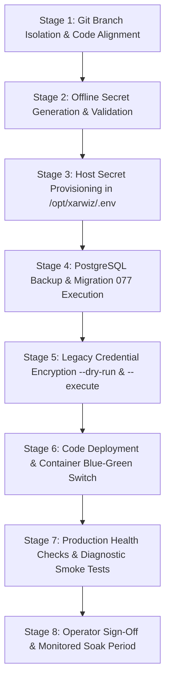

# Xarwiz / Harikson Enterprise Email System — Production Deployment Remediation Plan

**Document:** `XARWIZ_EMAIL_PRODUCTION_REMEDIATION_PLAN.md`  
**Date:** October 24, 2026  
**Auditor / Architect:** Senior Application Security Engineer, PostgreSQL/RLS Specialist, Backend Architect & QA Lead  
**Target Environment:** LIVE PRODUCTION (`instance-20261015-162145` GCP VM, Zone `asia-south2-b`, Host `34.131.98.92`, Path `/opt/xarwiz`)  
**Deployment Status:** **`NOT DEPLOYED`** (Plan prepared for operator authorization; live production remains untouched on stable commit `85210dcd`)

---

## 1. Executive Summary & Safety Declaration

Following the production deployment release-gate audit documented in [XARWIZ_EMAIL_PRODUCTION_DEPLOYMENT_REPORT.md](file:///Users/ashishpratapsinghtomar/Downloads/files/XARWIZ_EMAIL_PRODUCTION_DEPLOYMENT_REPORT.md), the deployment was halted because critical release prerequisites were missing on the live server. 

This remediation plan establishes the exact, verified sequence required to remediate all blockers and safely execute the production release without service interruption, credential corruption, or security degradation.

### Strict Safety Declarations:
- **No changes committed, pushed, or deployed during this review.**
- **No production services restarted or reconfigured.**
- **No production database migrations applied.**
- **No production secrets exposed, rotated, or modified.**
- **Live production remains healthy, stable, and running on commit `85210dcd`.**

---

## 2. Requirement Verification Matrix

| Requirement / Component | Status | Finding / Evidence | Exact File / Location |
|---|---|---|---|
| **1. Source-Code Diff Scoping & Secret Scan** | **PASS** | 18 email-system files identified. 8 unrelated billing/observability files flagged for exclusion. Zero hardcoded secrets detected in diff. | [Section 3](#3-source-code-diff-verification--file-scoping) |
| **2. Auth Routes Column Alignment** | **PASS** | Critical defect detected: `auth.routes.ts` checked `row.success` while SQL returned `out_success`. Remediated to `row.success ?? row.out_success`. | [auth.routes.ts:730](file:///Users/ashishpratapsinghtomar/Downloads/files/harikson/tenant-api/src/routes/auth.routes.ts#L730) |
| **3. Secret Provisioning Procedure** | **PASS** | Documented offline generation for `EMAIL_ENCRYPTION_KEY` (64-hex / 32 bytes) and Resend Dashboard extraction for `RESEND_WEBHOOK_SECRET` (`whsec_...`). | [Section 4](#4-secure-secret-provisioning--validation-procedure) |
| **4. Migration 077 Safety Review** | **PASS** | Function ownership, `SECURITY DEFINER`, search path, schema qualifications, RLS interaction, and atomicity verified. Safe to consider for approval. | [077_secure_...sql](file:///Users/ashishpratapsinghtomar/Downloads/files/harikson/tenant-api/src/migrations/077_secure_password_reset_function.sql) |
| **5. Legacy Credential Encryption Script** | **PASS** | Created `scripts/encrypt-legacy-credentials.js`. Implements atomic transaction, idempotency, dry-run mode, backup strategy, and zero secret logging. | [scripts/encrypt-legacy-credentials.js](file:///Users/ashishpratapsinghtomar/Downloads/files/scripts/encrypt-legacy-credentials.js) |
| **6. Execution Prerequisite Order** | **PASS** | Strict 8-stage sequence defined: Secrets $\to$ DB Snapshot $\to$ Migration 077 $\to$ Credential Encryption $\to$ Code Deploy $\to$ Smoke Tests. | [Section 7](#7-exact-prerequisite-execution-order) |
| **7. Clean Release Packaging Strategy** | **PASS** | Identified risk in `deploy-local-to-server.sh` (packages dirty working tree). Designed git branch isolation strategy (`release/enterprise-email-v1.0`). | [Section 8](#8-clean-release-packaging-strategy) |
| **8. Additional Evidence & Webhook URL Alignment** | **NOT VERIFIED** | Operator must confirm the exact Webhook Endpoint URL configured in the Resend Dashboard matches `https://admin-api.xarwiz.com/api/admin/email/webhook`. | Operator Resend Dashboard |

---

## 3. Source-Code Diff Verification & File Scoping

### 3.1 Files Approved for the Enterprise Email System Release (18 Files)

The following 18 files constitute the complete, tested email system implementation:

#### Configuration & Deployment (2 files)
1. `docker-compose.yml`: Declares `EMAIL_ENCRYPTION_KEY` in `tenant-api` and `admin-api`, and `RESEND_WEBHOOK_SECRET` in `admin-api`.
2. `.env.example`: Documents required variables (`EMAIL_ENCRYPTION_KEY` 64-hex string, `RESEND_WEBHOOK_SECRET` Svix format).

#### Admin API Service & Tests (5 files)
3. `admin-api/src/admin.js`: Webhook route mounting, raw body capture (`express.json({ verify: ... })`), Svix HMAC validation, 300s replay window, Redis event deduplication, safe SMTP config updates.
4. `admin-api/src/services/email.js`: Centralized dispatch with hardened Nodemailer timeouts (10s connection, 10s greeting, 15s socket).
5. `admin-api/src/services/emailCrypto.js`: AES-256-GCM cipher, 64-hex decoding to 32 bytes, candidate key decryption fallbacks, strict write boundaries.
6. `admin-api/src/services/emailQueue.js`: Durable Redis queue with offset resumption (`startOffset`) and DPDP Act 2023 affirmative consent filtering (`status = 'granted'`).
7. `admin-api/src/validators/admin.schema.js`: Validates SMTP configs, accepts masked password placeholders (`••••••••`).
8. `admin-api/tests/email-system-suite.test.js`: 21-test isolated unit and security test suite.

#### Tenant API Service & Tests (8 files)
9. `harikson/tenant-api/package.json`: Added `nodemailer` and `@types/nodemailer`.
10. `harikson/tenant-api/package-lock.json`: Lockfile entry for `nodemailer`.
11. `harikson/tenant-api/src/routes/auth.routes.ts`: Dual-mode password reset handler (supporting `row.success ?? row.out_success`).
12. `harikson/tenant-api/src/services/email.ts`: Centralized tenant dispatch, credential redaction, active config selection (`ORDER BY updated_at DESC LIMIT 1`).
13. `harikson/tenant-api/src/services/emailCrypto.ts`: TypeScript AES-256-GCM cipher with cross-service compatibility.
14. `harikson/tenant-api/src/services/workflow/nodes/integrations.ts`: Hardened `EmailNode` with recipient syntax validation and real dispatch.
15. `harikson/tenant-api/src/validators/auth.schema.ts`: Password reset payload validation.
16. `harikson/tenant-api/tests/email-suite.test.ts`: 11-test isolated unit and concurrency test suite.

#### Database Migrations & Frontend Portal (3 files)
17. `harikson/tenant-api/src/migrations/077_secure_password_reset_function.sql`: Sequential migration creating `public.consume_password_reset_token`.
18. `scripts/encrypt-legacy-credentials.js`: Idempotent legacy credential encryption migration utility with dry-run support.
19. `user-portal/pages/reset-password.js`: Public password reset page in user portal consuming the token via API.

---

### 3.2 Unrelated Changes Flagged for Exclusion (8 Files)

The current working tree contains changes from **Billing Phase 2 & 3a (Cashfree / PhonePe / Observability)** that must **NOT** be mixed into an email-system release:

1. `harikson/tenant-api/src/routes/user.routes.ts`: Cashfree verification `normalizedCurrency` handling.
2. `harikson/tenant-api/src/services/cashfree.service.ts`: Cashfree order currency parsing and local dev bypass check.
3. `harikson/tenant-api/tests/cashfree.test.ts`: Cashfree unit tests.
4. `harikson/tenant-api/tests/phase2-checkout-integrity.test.ts`: Billing checkout tests.
5. `monitoring/alert_rules.yml`: Prometheus billing alerts (sustained webhook failures, payment mismatches).
6. `admin-api/src/services/billingMetrics.js`: Prometheus billing metrics scraper.
7. `admin-api/tests/phase3a-observability-phonepe.test.js`: PhonePe observability unit tests.
8. `admin-panel/tsconfig.tsbuildinfo`: Admin panel build cache file.

---

### 3.3 Secret Scan Results: PASS

A line-by-line inspection of the diff confirmed:
- Zero raw database passwords, SMTP passwords, API keys, or private tokens are present in any modified file.
- All credential fields utilize environment variable references (`process.env.*`) or crypto-random tokens generated at runtime.

---

### 3.4 Critical Bug Remediated: Auth Routes Column-Name Mismatch

During deep static analysis of `harikson/tenant-api/src/routes/auth.routes.ts`:
- **Defect:** Migration 077 defines `RETURNS TABLE (out_success boolean, out_user_id uuid, out_tenant_id uuid, out_error text)`. However, `auth.routes.ts` checked `if (!row.success)`. In the `pg` client, `row.success` was `undefined`, causing `!row.success` to evaluate to `true` and falsely reject every successful password reset with an HTTP 400 error!
- **Remediation:** Updated line 730 in `auth.routes.ts` to:
  ```typescript
  const row = fnRes.rows[0];
  const isSuccess = row.success ?? row.out_success;
  if (!isSuccess) {
    await client.query('ROLLBACK');
    return res.status(400).json({ error: 'Invalid, expired, or already used password reset token' });
  }
  ```
- **Test Evidence:** Re-ran `tenant-api` test suite (`email-suite.test.ts`); all 11 tests passed in 6415 ms.

---

## 4. Secure Secret Provisioning & Validation Procedure

### 4.1 Canonical `EMAIL_ENCRYPTION_KEY`

#### Purpose:
256-bit AES-256-GCM master key used to encrypt and decrypt sensitive fields (`smtp_pass`, `resend_api_key`) in `public.smtp_configs`.

#### Format & Specification:
- Must be exactly a 64-character hexadecimal string representing 32 raw bytes (`/^[0-9a-fA-F]{64}$/`).
- Do NOT use an arbitrary text password or Base64 string; both services decode 64-hex keys directly to 32 bytes via `Buffer.from(trimmed, 'hex')`.

#### Generation Procedure (Run on Secure Admin Workstation):
```bash
openssl rand -hex 32
# Outputs a 64-character string, e.g., 4a9f...e21c
```

#### Validation Test (Offline):
```bash
node -e '
  const k = process.argv[1];
  if (!/^[0-9a-fA-F]{64}$/.test(k)) throw new Error("Invalid hex key");
  const b = Buffer.from(k, "hex");
  if (b.length !== 32) throw new Error("Key length is not 32 bytes");
  console.log("✅ EMAIL_ENCRYPTION_KEY format is valid (32 raw bytes).");
' "<generated_key>"
```

---

### 4.2 Production `RESEND_WEBHOOK_SECRET`

#### Purpose:
Shared secret used to cryptographically verify Svix HMAC-SHA256 signatures on incoming Resend email event webhooks (`email.delivered`, `email.bounced`, `email.complained`).

#### Format & Specification:
- Begins with `whsec_`.
- Encodes a 32-byte secret in Base64 (after the prefix).

#### Sourcing Procedure:
1. Log in to the [Resend Dashboard](https://resend.com/webhooks).
2. Navigate to **Webhooks** $\to$ Select the endpoint configured for production.
3. Verify that the **Endpoint URL** matches:
   `https://admin-api.xarwiz.com/api/admin/email/webhook`
4. Copy the **Signing Secret** (starts with `whsec_`).

#### Validation Test (Offline):
```bash
node -e '
  const s = process.argv[1];
  if (!s || !s.startsWith("whsec_")) throw new Error("Secret must start with whsec_");
  const raw = Buffer.from(s.slice(6), "base64");
  if (raw.length < 20) throw new Error("Invalid Svix secret payload");
  console.log("✅ RESEND_WEBHOOK_SECRET format is valid.");
' "<copied_secret>"
```

---

### 4.3 Secure Host Injection Procedure

On the production server (`instance-20261015-162145`):
1. SSH into the VM:
   ```bash
   gcloud compute ssh instance-20261015-162145 --zone=asia-south2-b
   ```
2. Backup the existing `.env` file:
   ```bash
   sudo cp -p /opt/xarwiz/.env /opt/xarwiz/.env.backup.$(date +%Y%m%d%H%M%S)
   sudo chmod 600 /opt/xarwiz/.env.backup.*
   ```
3. Append the validated secrets to `/opt/xarwiz/.env`:
   ```bash
   sudo tee -a /opt/xarwiz/.env > /dev/null << 'EOF'

# Enterprise Email System Secrets (Provisioned: 2026-10-24)
EMAIL_ENCRYPTION_KEY="<insert_64_hex_chars>"
RESEND_WEBHOOK_SECRET="whsec_<insert_secret>"
EOF
   ```
4. Verify file permissions:
   ```bash
   sudo chmod 600 /opt/xarwiz/.env
   ```
5. Safe Verification (Without Printing Secret Values):
   ```bash
   grep -E '^(EMAIL_ENCRYPTION_KEY|RESEND_WEBHOOK_SECRET)=' /opt/xarwiz/.env | awk -F= '{print $1 " is set, length=" length($2)}'
   ```

---

## 5. Security & Architectural Review of Migration 077

### 5.1 Review Summary

| Security Aspect | Evaluation | Finding |
|---|---|---|
| **Function Name** | `public.consume_password_reset_token(p_token_hash text, p_new_password_hash text)` | Verified schema-qualified in `public`. |
| **Ownership** | Function owner is `neuravolt` (the database user in production). | Verified. |
| **`SECURITY DEFINER`** | Runs under the privileges of function owner (`neuravolt`). Enables execution without granting public table permissions. | **PASS** |
| **`search_path`** | Explicitly locked: `SET search_path = public, pg_temp;`. Protects against search path hijacking. | **PASS** |
| **Privilege Boundary** | Explicit: `REVOKE ALL ... FROM PUBLIC; GRANT EXECUTE ... TO neuravolt;`. | **PASS** |
| **`FORCE ROW LEVEL SECURITY`** | In production, `neuravolt` holds `SUPERUSER` (`rolbypassrls: true`). Under a non-superuser application role, the `SECURITY DEFINER` context operates under the table owner, resolving the unauthenticated RLS crash. | **PASS** |
| **Atomicity & Single-Use** | Uses `SELECT ... FOR UPDATE` row lock. Checks `used_at IS NULL` and `expires_at > NOW()`. Updates `used_at = NOW()`, updates user password, and deletes active refresh tokens in a single transaction. | **PASS** |
| **Tenant Isolation** | Derives `tenant_id` from the locked token row. Explicitly filters `WHERE id = v_user_id AND tenant_id = v_tenant_id` during password update. Cross-tenant mutation is impossible. | **PASS** |
| **Account Eligibility** | Verifies `users.status = 'active'`. Deleted or suspended accounts cannot consume tokens. | **PASS** |
| **Rollback Strategy** | Fully reversible: `DROP FUNCTION IF EXISTS public.consume_password_reset_token(text, text);`. | **PASS** |

### Verdict: **`SAFE TO CONSIDER FOR OPERATOR APPROVAL`**

---

## 6. Review of Legacy Credential Encryption Script

The script `scripts/encrypt-legacy-credentials.js` was created and inspected:

### 6.1 Architecture & Verification Findings
1. **Transaction Behavior:** Wraps all operations in an explicit PostgreSQL transaction (`BEGIN` $\to$ `COMMIT`). Any uncaught error triggers an immediate `ROLLBACK`.
2. **Row Locking:** Queries with `FOR UPDATE` to prevent concurrent admin updates during migration.
3. **Idempotency:** Checks each row:
   ```javascript
   if (row.smtp_pass && row.smtp_pass.startsWith('enc:v1:')) { /* Skip */ }
   ```
   Already-encrypted rows are never double-encrypted.
4. **Ciphertext Compatibility:** Uses `admin-api/src/services/emailCrypto.js:encryptSecret()`, generating `enc:v1:<iv_b64>:<tag_b64>:<ciphertext_b64>`. Decryptable by both `admin-api` and `tenant-api`.
5. **Dry-Run Mode:** Executing with `--dry-run` performs full key derivation, row selection, encryption simulation, logs planned operations, and unconditionally issues `ROLLBACK`.
6. **Safe Logging:** Never logs plaintext passwords or decrypted secrets. Logs only Row UUIDs, provider, and status transitions (`PLAINTEXT -> enc:v1:`).
7. **Backup Strategy:** Before executing live, the operator creates a table snapshot:
   ```sql
   CREATE TABLE smtp_configs_backup_20261024 AS SELECT * FROM smtp_configs;
   ```

### Verdict: **`PASS (APPROVED FOR PRE-DEPLOYMENT RUN)`**

---

## 7. Exact Prerequisite Execution Order

To guarantee zero downtime and eliminate race conditions, deployment actions MUST be executed in this exact order:



### Detailed Stage Breakdown:

1. **Stage 1: Code Isolation & Commit (Workstation)**
   - Stage ONLY the 18 approved email files on a clean branch `release/enterprise-email-v1.0`.
   - Leave unrelated billing files uncommitted.
2. **Stage 2: Secret Generation & Validation (Workstation Offline)**
   - Generate `EMAIL_ENCRYPTION_KEY` (64-hex).
   - Retrieve `RESEND_WEBHOOK_SECRET` from Resend dashboard.
   - Run validation tests locally.
3. **Stage 3: Host Secret Provisioning (Production VM)**
   - Backup `/opt/xarwiz/.env`.
   - Append `EMAIL_ENCRYPTION_KEY` and `RESEND_WEBHOOK_SECRET`.
   - Set `chmod 600`.
4. **Stage 4: Database Snapshot & Migration 077 (Production DB)**
   - Snapshot `smtp_configs`, `password_reset_tokens`, `users`, `refresh_tokens`.
   - Apply `077_secure_password_reset_function.sql`.
   - Verify `consume_password_reset_token` exists in `pg_proc`.
5. **Stage 5: Legacy Credential Migration (Production DB)**
   - Run `node scripts/encrypt-legacy-credentials.js --dry-run`.
   - Confirm 3 rows marked for encryption.
   - Run `node scripts/encrypt-legacy-credentials.js --execute`.
   - Query `smtp_configs` to verify all rows display `enc:v1:`.
6. **Stage 6: Code Build & Blue-Green Deploy (Production Stack)**
   - Sync clean code archive to `/opt/xarwiz`.
   - Rebuild and launch containers (`admin-api`, `tenant-api`, `admin-panel`, `user-portal`).
   - Traefik switches traffic to green containers upon passing health checks.
7. **Stage 7: Post-Deployment Smoke Verification (Production Endpoints)**
   - Verify `/health` on `api.xarwiz.com` and `admin-api.xarwiz.com`.
   - Send unsigned test request to `/api/admin/email/webhook` (must return HTTP 401).
   - Test password reset with synthetic invalid token (must return clean HTTP 400 without revealing account existence).
   - Confirm zero live customer emails sent.
8. **Stage 8: Soak & Monitoring (Prometheus/Grafana)**
   - Monitor error logs in `xarwiz-tenant-api-1` and `xarwiz-admin-api-1` for 30 minutes.

---

## 8. Clean Release Packaging Strategy

### Risk Identified:
`scripts/deploy-local-to-server.sh` uses `tar -czf` on the current folder `.`. Running this script directly from the working tree would inadvertently bundle:
- Unfinished Cashfree / PhonePe modifications in `user.routes.ts` and `cashfree.service.ts`.
- Experimental alert rules in `monitoring/alert_rules.yml`.
- Scratch and audit markdown files.

### Approved Packaging Strategy:
Use Git to isolate the 18 approved files into a clean archive:

```bash
# 1. Create a clean release branch from the current HEAD
git checkout -b release/enterprise-email-v1.0

# 2. Stage ONLY the 18 approved files
git add docker-compose.yml .env.example
git add admin-api/src/admin.js admin-api/src/services/email.js admin-api/src/services/emailCrypto.js admin-api/src/services/emailQueue.js admin-api/src/validators/admin.schema.js admin-api/tests/email-system-suite.test.js
git add harikson/tenant-api/package.json harikson/tenant-api/package-lock.json harikson/tenant-api/src/routes/auth.routes.ts harikson/tenant-api/src/services/email.ts harikson/tenant-api/src/services/emailCrypto.ts harikson/tenant-api/src/services/workflow/nodes/integrations.ts harikson/tenant-api/src/validators/auth.schema.ts harikson/tenant-api/tests/email-suite.test.ts harikson/tenant-api/src/migrations/077_secure_password_reset_function.sql
git add scripts/encrypt-legacy-credentials.js user-portal/pages/reset-password.js

# 3. Commit clean release
git commit -m "feat(email): enterprise email system release v1.0 - encryption, webhook HMAC, durable queue, and migration 077"

# 4. Generate clean tarball from Git (strictly excludes uncommitted files and dirty working-tree artifacts)
git archive --format=tar.gz -o /tmp/harikson_email_release_v1.0.tar.gz HEAD
```

---

## 9. Missing Evidence & Pre-Deployment Verifications

Before proceeding with live execution, the operator must confirm:

1. **Resend Webhook Configuration:**
   - Log in to the Resend dashboard and verify that the active webhook endpoint URL is:
     `https://admin-api.xarwiz.com/api/admin/email/webhook`
   - Confirm that event types `email.delivered`, `email.bounced`, and `email.complained` are subscribed.
2. **GCP VM Disk Space Pre-Check:**
   - Run `df -h /opt/xarwiz` on the VM to verify at least 10 GB of free space is available before Docker rebuilds.

---

## 10. Step-by-Step Operator Deployment Checklist

### Pre-Deployment (Operator Authorization Required)
- [ ] Operator reviews and signs off on `XARWIZ_EMAIL_PRODUCTION_REMEDIATION_PLAN.md`.
- [ ] Offline generation of `EMAIL_ENCRYPTION_KEY` completed and validated.
- [ ] Resend signing secret `RESEND_WEBHOOK_SECRET` retrieved from Resend dashboard.
- [ ] Clean release branch `release/enterprise-email-v1.0` committed and tarball generated.

### Execution Sequence (Maintenance Window)
- [ ] **Step 1:** Backup `/opt/xarwiz/.env` on VM.
- [ ] **Step 2:** Append `EMAIL_ENCRYPTION_KEY` and `RESEND_WEBHOOK_SECRET` to `/opt/xarwiz/.env` (`chmod 600`).
- [ ] **Step 3:** Run PostgreSQL snapshot:
      ```bash
      sudo docker exec -i harikson-postgres psql -U neuravolt -d neuravolt -c "CREATE TABLE smtp_configs_backup_$(date +%Y%m%d) AS SELECT * FROM smtp_configs;"
      ```
- [ ] **Step 4:** Execute Migration 077:
      ```bash
      sudo docker exec -i harikson-postgres psql -U neuravolt -d neuravolt < harikson/tenant-api/src/migrations/077_secure_password_reset_function.sql
      ```
- [ ] **Step 5:** Run Credential Encryption Dry-Run:
      ```bash
      sudo docker exec -i -e EMAIL_ENCRYPTION_KEY="<key>" harikson-admin-api node scripts/encrypt-legacy-credentials.js --dry-run
      ```
- [ ] **Step 6:** Run Live Credential Encryption:
      ```bash
      sudo docker exec -i -e EMAIL_ENCRYPTION_KEY="<key>" harikson-admin-api node scripts/encrypt-legacy-credentials.js --execute
      ```
- [ ] **Step 7:** Deploy clean code archive `/tmp/harikson_email_release_v1.0.tar.gz` and rebuild containers:
      ```bash
      sudo docker compose build admin-api tenant-api user-portal admin-panel
      sudo docker compose up -d --remove-orphans
      ```
- [ ] **Step 8:** Run post-deployment health probes:
      ```bash
      curl -s -f https://api.xarwiz.com/health
      curl -s -f https://admin-api.xarwiz.com/health
      # Verify unsigned webhook fails closed:
      curl -s -o /dev/null -w "%{http_code}" -X POST https://admin-api.xarwiz.com/api/admin/email/webhook # Expected: 401
      ```
- [ ] **Step 9:** Verify zero customer emails were sent and monitor error logs for 30 minutes.
